# Forward Deployed Engineering Lab (`fde-lab`)

**Enterprise AI/DR Architecture Comparison, Progressive RAG Document Assistant (`v1 → v3`), and Governed Sentinel Use-Case Deployment (`v1` Baseline)**

---

## 1. Purpose and Scope

This public repository hosts three Forward Deployed Engineering (FDE) and cybersecurity architecture deliverables:

| Component | Path | Problem & Intended Users | Verification & Inspectable Artifacts |
| :--- | :--- | :--- | :--- |
| **1. Enterprise AI/DR Architecture Comparison** | [`microsoft_vs_crowdstrike_ai_dr_guide.md`](microsoft_vs_crowdstrike_ai_dr_guide.md) | **For CISOs, Security Architects & SOC Leads:** Evaluates how **Microsoft Security** (Defender XDR, Sentinel, Entra Agent ID, Purview, Security Copilot) and **CrowdStrike Falcon** (Falcon Sensor, Next-Gen SIEM, Charlotte AI, Falcon Guardian) address AI for SecOps, runtime defense for AI, and AI governance. | **491-line architecture guide** with 8 Mermaid diagrams, 4 end-to-end attack scenarios, and a 20-item customer assessment checklist. |
| **2. Document Assistant Progression (`v1 → v3`)** | [`document-assistant/`](document-assistant/) | **For Applied AI & Security Engineers:** Demonstrates how a local TF-IDF prototype (`v1-retrieval`) and basic RAG app (`v2-ai-assistant`) evolve into a decoupled FastAPI + Streamlit service (`v3-enterprise-assistant`) with constant-time Bearer API-key verification, sliding-window rate limiting, and non-root container isolation. | **32 automated `pytest` tests** across 9 test files in [`v3-enterprise-assistant/tests/`](document-assistant/versions/v3-enterprise-assistant/tests/) + [`app/security.py`](document-assistant/versions/v3-enterprise-assistant/app/security.py) + [`docs/security.md`](document-assistant/versions/v3-enterprise-assistant/docs/security.md) + ADRs (`ADR-001`..`ADR-006`). |
| **3. Sentinel Use-Case Deployment (`v1` Baseline)** | [`sentinel-usecase-deployment/`](sentinel-usecase-deployment/) | **For Detection Engineers & SecOps Teams:** Generates, validates, and packages a Microsoft Sentinel Scheduled KQL analytics rule (*Entra ID single-IP password spray* on `SigninLogs`) behind a two-layer static/semantic KQL validator, human approval gate, and mandatory `enabled = false` safety invariant. | **28 automated `pytest` tests** across 5 test files in [`sentinel-usecase-deployment/tests/`](sentinel-usecase-deployment/tests/) + [`reference_proposer.py`](sentinel-usecase-deployment/src/sentinel_usecase/agent/reference_proposer.py) + [`structural.py`](sentinel-usecase-deployment/src/sentinel_usecase/validation/structural.py) + [`workflow.py`](sentinel-usecase-deployment/src/sentinel_usecase/workflow.py). |

> **Canonical Evolution Notice for Sentinel Use-Case Deployment:** The `sentinel-usecase-deployment/` directory in this repository is the frozen **V1 baseline** (`2026-08-16`), supporting a single Entra ID password-spray template via PowerShell preview/apply deployment. Subsequent multi-table development (**V2 through V3.4**—adding live Log Analytics schema discovery, bounded historical backtesting, Python ARM REST deployment, Terraform export, and SHA-256 readiness gates) is documented in the portfolio case study [**`ai-agent-usecase-deployment` (V3.4)**](https://github.com/86sunbot/portfolio/blob/main/ai-agents.md#1-ai-assisted-microsoft-sentinel-detection-engineering-agent-ai-agent-usecase-deployment-v34).

---

## 2. Repository Architecture Overview

```mermaid
flowchart TD
    subgraph Arch ["1. Enterprise AI/DR Architecture Comparison"]
        A1["microsoft_vs_crowdstrike_ai_dr_guide.md: Defender XDR + Sentinel + Entra Agent ID vs. Falcon + Next-Gen SIEM + Guardian"]
    end

    subgraph RAG ["2. Document Assistant v3 (FastAPI + Streamlit)"]
        R1["Streamlit UI / Client"] -->|"Bearer API Key + Sliding-Window Rate Limit"| R2["FastAPI Boundary (app/security.py & app/main.py)"]
        R2 --> R3["Vector Retrieval, Lexical Reranker & Grounded Citation Engine"]
    end

    subgraph SentinelV1 ["3. Sentinel Use-Case Deployment v1 (Governed Agent Workflow)"]
        S1["Natural-Language Request"] --> S2["Proposer (OpenAIRuleProposer or ReferencePasswordSprayProposer)"]
        S2 --> S3["RuleValidator (structural.py & detection.py) + Single-Pass Repair"]
        S3 --> S4["Human Approval Gate (ApprovalDecision.APPROVE)"]
        S4 --> S5["UseCaseWorkflow.deploy & PowerShellCsvDeploymentGateway (Re-validates + enforces enabled = false)"]
    end
```



---

## 3. Representative Artifacts Visitors Can Inspect Now

1. **Enterprise AI/DR Architecture Comparison:**
   - [`microsoft_vs_crowdstrike_ai_dr_guide.md`](microsoft_vs_crowdstrike_ai_dr_guide.md) — Compares telemetry architecture, Shadow AI browser DLP, AI agent identity governance (`Entra Agent ID` vs. service-account monitoring), token FinOps vs. kernel token telemetry, and 4 real-world attack scenarios.
2. **Enterprise RAG Service Security Boundary & ADRs (`v3-enterprise-assistant`):**
   - [`document-assistant/versions/v3-enterprise-assistant/app/security.py`](document-assistant/versions/v3-enterprise-assistant/app/security.py) & [`docs/security.md`](document-assistant/versions/v3-enterprise-assistant/docs/security.md) — Constant-time `secrets.compare_digest` Bearer API-key verification (`require_api_key`), SHA-256 client-ID keyed `InMemoryRateLimiter` (`enforce_rate_limit`), and threat/mitigation table.
   - [`document-assistant/versions/v3-enterprise-assistant/docs/decisions/`](document-assistant/versions/v3-enterprise-assistant/docs/decisions/) — Six Architecture Decision Records (`ADR-001` through `ADR-006`).
3. **Microsoft Sentinel KQL Rule, Two-Layer Validator & Governed Agent Workflow (`sentinel-usecase-deployment`):**
   - [`sentinel-usecase-deployment/src/sentinel_usecase/agent/reference_proposer.py`](sentinel-usecase-deployment/src/sentinel_usecase/agent/reference_proposer.py) — Complete Scheduled KQL rule for *Microsoft Entra ID password spray from a single IP* (`SigninLogs`, `DetectionWindow = 15m`, `MinimumDistinctAccounts = 10`, `MinimumFailedAttempts = 20`, `IP` and `Account` entity mappings).
   - [`sentinel-usecase-deployment/src/sentinel_usecase/validation/structural.py`](sentinel-usecase-deployment/src/sentinel_usecase/validation/structural.py) & [`detection.py`](sentinel-usecase-deployment/src/sentinel_usecase/validation/detection.py) — Structural and semantic KQL validation (`StructuralValidator` and `PasswordSprayDetectionValidator`) enforcing `enabled = False`, blocking destructive KQL commands (`.create`, `.drop`, `externaldata`), verifying required tables/columns, and checking `let` parameter agreement.
   - [`sentinel-usecase-deployment/src/sentinel_usecase/workflow.py`](sentinel-usecase-deployment/src/sentinel_usecase/workflow.py), [`deployment/gateway.py`](sentinel-usecase-deployment/src/sentinel_usecase/deployment/gateway.py), & [`scripts/Smoke-Test-SentinelDeployment.ps1`](sentinel-usecase-deployment/scripts/Smoke-Test-SentinelDeployment.ps1) — Orchestrates generation (`UseCaseWorkflow.generate`), single-pass validation repair, pre-deployment re-validation and human approval (`UseCaseWorkflow.deploy` requiring `ApprovalDecision.APPROVE`), and disabled-by-default PowerShell preview/apply deployment (`PowerShellCsvDeploymentGateway`).

---

## 4. Quick Start & Reproduction Instructions

### A. Document Assistant v3 (`document-assistant/versions/v3-enterprise-assistant`)
```bash
cd document-assistant/versions/v3-enterprise-assistant
python3 -m venv .venv && source .venv/bin/activate
pip install -r requirements-dev.txt
ruff check .
pytest -q
```

### B. Sentinel Use-Case Deployment v1 (`sentinel-usecase-deployment`)
```bash
cd sentinel-usecase-deployment
python3 -m venv .venv && source .venv/bin/activate
pip install -r requirements.txt -r requirements-dev.txt
ruff check .
PYTHONPATH=src pytest -q tests
# Optional: generate a validated offline reference artifact bundle
python run.py create "Create a password spray detection for Entra ID sign-in logs" --offline-reference
```

---

## 5. Validation Evidence & Known Limitations

- **Automated Test & CI Coverage ([`.github/workflows/v3-ci.yml`](.github/workflows/v3-ci.yml)):**
  - **`verify-document-assistant-v3`:** Runs `ruff check .`, **32 `pytest` unit/API/security/evaluation tests**, and `docker build`.
  - **`verify-sentinel-usecase-v1`:** Runs `ruff check .` and **28 `pytest` unit/validation/workflow/gateway tests** (`60` total automated tests across both suites).
- **Known Limitations:**
  - `document-assistant/versions/v1-retrieval` and `v2-ai-assistant` are preserved as earlier learning snapshots (validated manually with screenshots in `docs/images/`); automated CI testing starts in `v3-enterprise-assistant`.
  - `sentinel-usecase-deployment` is the frozen V1 baseline restricted to a single Entra ID password-spray pattern, and its KQL validator performs static/semantic checks rather than compiling or executing queries against a live Azure Log Analytics workspace.

---

## 6. Contribution & Third-Party Attribution

- **Author & Architecture / Code Contribution:** Sharat P Surya (`Surya PS`), CISSP — authored `microsoft_vs_crowdstrike_ai_dr_guide.md`, the `v1 → v3` Document Assistant progression, and the `sentinel-usecase-deployment` Python/PowerShell package ([Portfolio Catalogue](https://github.com/86sunbot/portfolio)).
- **Third-Party Test Fixture Attribution:** The sample PDF used as a retrieval test fixture in `document-assistant/versions/v2-ai-assistant/document.pdf` and `v3-enterprise-assistant/document.pdf` is a 4-page print-to-PDF excerpt of public Microsoft Learn documentation (*"Microsoft Defender for Identity Overview"*), included solely as an offline document-chunking fixture.
